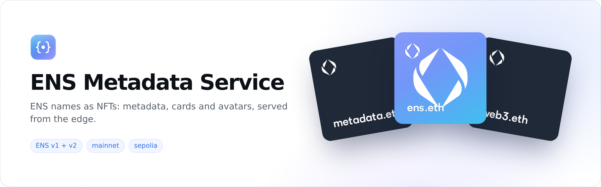
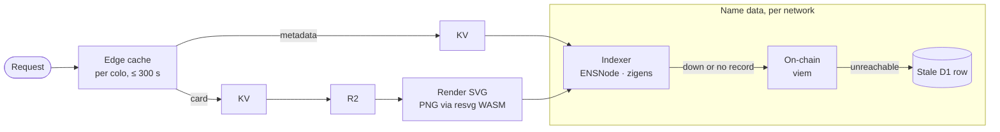

<picture>
  <source media="(prefers-color-scheme: dark)" srcset=".github/assets/banner-dark.png">
  
</picture>

<p align="center">
  <a href="https://github.com/ensdomains/metadata-service-v2/actions/workflows/ci.yml"></a>
  
  
  
</p>

<p align="center">
  <a href="#example">Example</a> ·
  <a href="#api">API</a> ·
  <a href="#architecture">Architecture</a> ·
  <a href="#development">Development</a> ·
  <a href="#deployment">Deployment</a> ·
  <a href="#environment-variables">Environment variables</a>
</p>

---

Next-generation ENS metadata service built on Cloudflare Workers for ENS v1 and v2 on Ethereum (mainnet + sepolia testnet).

- **ENS v1 & v2 Support**: Native v2 names and legacy v1 names on Ethereum
- **High Performance**: Cloudflare Workers edge computing with global distribution
- **Smart Caching**: Edge + KV + R2 caching; the KV and R2 tiers use migration-aware, stale-while-revalidate TTLs, while the per-colo edge tier is a flat 300s cap
- **Fallback Resilience**: For name lookups, direct chain queries when the indexers are unavailable *or* simply don't know the name, then a stale D1 row as a last resort (the `contract/tokenId` reverse lookup is indexer-only)
- **SVG Generation**: Canvas-free SVG card generation, with in-Worker PNG rasterization via resvg/HarfBuzz WASM

## Example

```bash
curl https://ens-metadata.ens-cf.workers.dev/mainnet/registry/ethereum.eth         # metadata (JSON)
curl https://ens-metadata.ens-cf.workers.dev/mainnet/registry/ethereum.eth/image   # NFT card (SVG)
curl https://ens-metadata.ens-cf.workers.dev/mainnet/avatar/ethereum.eth           # avatar image
```

<p>
  
  
  
</p>

<sub>Rendered live by the deployment.</sub>

## API

`{network}` is `mainnet` or `sepolia`. Opened in a browser tab, an image endpoint shows a page with the image and the endpoint's documentation; ``, `fetch()` and API clients get the image itself.

| Method | Path | Returns |
|---|---|---|
| `GET` | `/` | Service info (`service`, `version`, `status`, `timestamp`) |
| `GET` | `/{network}/{registryType}/{identifier}` | NFT metadata (JSON) |
| `GET` | `/{network}/{registryType}/{identifier}/image` | NFT card (SVG) |
| `GET` | `/{network}/{registryType}/{identifier}/rasterize` | NFT card (PNG) |
| `GET` | `/{network}/avatar/{name}` | Avatar image (the `avatar` text record) |
| `GET` | `/{network}/avatar/{name}/meta` | Avatar record metadata (JSON, v1 parity) |
| `GET` | `/{network}/header/{name}` | Header image (the `header` text record) |
| `GET` | `/migration-status/{name}?network=` | Migration status |
| `GET` | `/registry-hierarchy/{name}?network=` | Registry hierarchy |
| `POST` | `/batch-metadata` | Metadata for many names at once |
| `POST` | `/webhook` | Indexer webhook (HMAC-authenticated) |
| `GET` | `/health` | Health check |

<details>
<summary><b>Route details</b></summary>

- **`GET /{network}/{registryType}/{identifier}`**: NFT metadata. `registryType` = `registry` | `namewrapper`, or a contract address: the v1 BaseRegistrar, the v1 NameWrapper, or, where v2 is deployed, any v2 registry the indexer knows (the ETHRegistry, and the registries under names); any other address is a `404` (on a v2 network, a `503` while the indexer is down). `identifier` = ENS name, or that contract's token id (decimal or `0x` hex; on this route it may end in `.json`, as a v2 token URI can). A v2 token id is looked up in its own registry only, since the same id is in every registry with that label, and is served under the name that registry hangs under, never under another name that points its subregistry at it. An unreachable token (orphaned by a subregistry repoint, an unregistered label or an expired ancestor) and the root registry's top-level names are a `404`. The `contract/tokenId` → name step queries the indexers only (plus the cached on-chain discovery of the live v2 registries)
- **`GET /{network}/{registryType}/{identifier}/image`**: NFT card image (SVG). Names on ENS v2 (`migrated`, `native`) get the ENS v2 card: the name on a label over the avatar or, without one, the name's [etherloom](https://github.com/ensdomains/etherloom) weave; other names keep the v1 card. Optional `?w=&h=` (both required, each a whole decimal integer such as `300`, 100–2000 px; anything else, e.g. `100a` or `300.0`, is a `400`) and `?status=` (`unmigrated` | `migrated` | `native`; overrides the status, which picks the card and its cache TTL, but never the existence check)
- **Names that aren't normalized** are shown as metadata.ens.domains shows them, since they can pass for another name: the token id, shortened (`[0x1234...abcd].eth`), as the metadata `name` and on a red "Invalid name" card, with no avatar, no `url` and no `background_image`, and a description naming the actual name
- **`GET /{network}/{registryType}/{identifier}/rasterize`**: NFT card image rasterized to PNG. Same query params; `?w=`/`?h=` are ignored unless both are within 100–2000
- **`GET /{network}/avatar/{name}`**: Avatar image bytes (the `avatar` text record)
- **`GET /{network}/avatar/{name}/meta`**: Avatar record metadata (NFT `host_meta`, `is_owner`, `image_url`, …); v1 parity
- **`GET /{network}/header/{name}`**: Header/banner image bytes (the `header` text record)
- **`GET /migration-status/{name}?network=`**: Check migration status (network from the query param, default `mainnet`)
- **`GET /registry-hierarchy/{name}?network=`**: Get registry hierarchy (network from the query param, default `mainnet`). This route never answers `404` or `503`: when no indexer, chain or D1 source can resolve the name it returns a `200` placeholder hierarchy with zero-address owners (cached briefly)
- **`POST /batch-metadata`**: Batch metadata. JSON body `{ names: string[] (1–100 by default, `MAX_BATCH_NAMES`), network?: "mainnet" | "sepolia" (default `mainnet`), registryType?: "registry" | "namewrapper" (default `registry`) }`; names that differ only in case are resolved once; returns `{ results, total, successful, failed }`. The body is capped at 64 KiB before it is parsed: a larger `Content-Length`, or a chunked body that passes the cap, is a `413` (`{ "error": "Payload too large" }`) and the rest is not read; the cap counts the bytes as the runtime delivers them, so a compressed body is bounded too, and one that does not arrive as JSON is a `400` like any other malformed body
- **`POST /webhook`**: Indexer webhook (HMAC-authenticated): purges the KV and R2 caches for the name on both networks (edge entries for its `/image` and `/rasterize` URLs are evicted on the receiving colo only; everything else at the edge expires within 300s), records the name's migration status in D1 and re-warms the default card image (see `docs/webhook.md`)

</details>

| Status | Meaning |
|---|---|
| `400` | Bad input |
| `404` | Unknown name |
| `410` | Expired name |
| `429` | Rate limited |
| `503` | The name cannot be resolved because an indexer or RPC tier was unreachable |
| `504` | No answer within the 30 s request timeout |

An outage is never reported as a `404`: not on the metadata, image, rasterize and migration-status routes, nor on the avatar, header and avatar-meta routes (see below).

<details>
<summary><b>Avatar, header and card behaviour when an upstream fails</b></summary>

The avatar and header routes answer 404 when the name has no usable record, and
503 with a short `Cache-Control` when the lookup failed (RPC, CCIP gateway or
media host error, or the 8 s resolution timeout). An NFT card whose avatar
lookup failed is served without the avatar with `Cache-Control: public,
max-age=60`, is kept in the edge cache for a minute and is not stored in KV or
R2. A name whose upstream keeps failing (e.g. a gateway that answers 503 for a
suspended name) is therefore looked up again once a minute per colo. The edge
copy is served with a fresh `max-age=60`, so the avatar reappears within about
two minutes of the upstream recovering. A CCIP gateway's 4xx other than 401,
403, 408 and 429 is its final answer (EIP-3668) and counts as no record, as does
a gateway URL the service refuses; any other gateway status (401 and 403
included: an expired gateway key or a WAF blocking requests from Workers), and a
gateway that redirects to a refused host, fails the lookup.

</details>

## Architecture



- **Runtime**: Cloudflare Workers + Hono
- **Storage**: KV (metadata + SVG cache), R2 (fonts, L2 SVG cache, cached avatars), D1 (migration statuses + last-resort data tier), plus the per-colo Cloudflare edge cache (capped at 300s because the webhook cannot purge it globally)
- **Data Sources** (tiered, per network):
  - mainnet: ENSNode subgraph (v1 queries) → on-chain via viem → stale D1
  - sepolia: zigens ENS v2 indexer (primary) → ENSNode sepolia subgraph (v1 secondary) → on-chain via viem (live v2 registry discovery through the UniversalResolver proxy) → stale D1
  - The chain tier runs both when an indexer is down (upstream error) and when it has no record of the name (clean miss). A circuit breaker guards the **primary indexer tier only** (mainnet: the ENSNode subgraph; sepolia: zigens) — only an upstream error trips it (a miss never does), it stays open for 60s per isolate, and the sepolia secondary v1 subgraph and the on-chain tier have no breaker.
- **Networks**: Ethereum mainnet (ENS v1 + v2; v2 registries from config until the UniversalResolver serves v2) + Sepolia testnet (ENS v1 + v2)

## Development

```bash
# Install dependencies
pnpm install

# Start development server (also seeds the local R2 bucket with fonts and
# applies pending D1 migrations first — the `predev` step)
yarn dev

# Apply D1 migrations manually
pnpm db:migrate:local
pnpm db:migrate:remote

# Run tests
pnpm test

# Type checking
pnpm typecheck

# Linting
pnpm lint
```

`predev` uploads the rasterize font pack from `node_modules/rasterize-wasm/fonts/` and looks
for `Satoshi-Bold.ttf` in `node_modules/adaptive-layout-composer/assets/`, `../canvas-cf/assets/`
or `../../canvas-cf/assets/` (relative to the repo root). The published `adaptive-layout-composer`
package ships no `assets/` directory, so in practice the font comes from a `canvas-cf` checkout
next to this repo. If it is not found `predev` only warns, and the `/image` and `/rasterize`
endpoints return `500` locally until `fonts/Satoshi-Bold.ttf` exists in the local R2 bucket.

## Deployment

Trunk-based, with a stage Worker in front of prod. `main` is always on stage;
prod is the latest date tag.

| Git event | What runs | Deploys to |
|---|---|---|
| Push to a PR branch | Workers Builds: `wrangler preview --env stage`; GitHub: `ci.yml` | a Preview of the stage Worker, URL commented on the PR |
| Push (merge) to `main` | Workers Builds: stage D1 migrations, then `wrangler deploy --env stage` | `ens-metadata-stage` |
| Date tag on a `main` commit | GitHub: `release.yml` (tag-on-main check, checks, prod D1 migrations, deploy), after approval on the `prod` environment | `ens-metadata` |

The top level of `wrangler.toml` is prod and `[env.stage]` is stage. Wrangler
does not inherit vars or bindings into `[env.stage]` or `[env.stage.previews]`,
so a new var or binding goes into all three (`test/rate-limit.test.ts` checks
the rate limiters).

### Releasing to prod

Releases are tags named after the UTC date: `YYYY-MM-DD`, then
`YYYY-MM-DD.2`, `.3`, ... for further releases the same day. Never semver.

```bash
git switch main && git pull --tags
DAY=$(date -u +%F); TAG=$DAY; n=1                   # e.g. 2026-10-12
while git rev-parse -q --verify "refs/tags/$TAG" >/dev/null; do
  n=$((n + 1)); TAG="$DAY.$n"                       # already released today: next counter
done
git tag "$TAG" && git push origin "$TAG"
```

`release.yml` lists the changes since the previous release tag (one line per
merged PR, from `scripts/release-notes.mjs`) as the Worker version message and
as a GitHub release for the tag, created once the deploy succeeds. Preview
them with `node scripts/release-notes.mjs <tag>`. A tag on a commit that is
not on `main` is rejected.

### Creating the prod Worker (once)

```bash
# Set production secrets (once)
wrangler secret put MAINNET_RPC_URL --env=""
wrangler secret put SEPOLIA_RPC_URL --env=""
wrangler secret put WEBHOOK_SECRET --env=""

# Upload font assets to the production R2 bucket (once). Without them /image and
# /rasterize return 500 on every cache miss and the Worker logs
# "Font not found in R2: fonts/<file>".
node scripts/upload-fonts-to-r2.mjs --remote   # rasterize font pack + twemoji → fonts/*.br
wrangler r2 object put ens-metadata-asset-bucket/fonts/Satoshi-Bold.ttf --file=/path/to/Satoshi-Bold.ttf --remote --jurisdiction eu --env=""

# Apply D1 migrations to the remote database (once per new migration)
pnpm db:migrate:remote
```

### Stage and Preview secrets and assets (once)

```bash
# Secrets are per Worker, and Previews have their own store
wrangler secret put MAINNET_RPC_URL --env stage                         # stage
wrangler preview base-config secret put MAINNET_RPC_URL --env stage     # Previews
# ...and the same for SEPOLIA_RPC_URL and WEBHOOK_SECRET

node scripts/upload-fonts-to-r2.mjs --remote --env stage
wrangler r2 object put ens-metadata-stage-asset-bucket/fonts/Satoshi-Bold.ttf --file=/path/to/Satoshi-Bold.ttf --remote --jurisdiction eu --env stage
```

KV namespaces and R2 buckets are created by a Worker's first deploy and
named `<worker name>-<binding>` (e.g. `ens-metadata-stage-asset-bucket`,
in the EU jurisdiction); wrangler finds them by name afterwards, so
`wrangler.toml` holds no ids. D1 databases are created by hand, e.g.
`wrangler d1 create ens-metadata-stage-db --jurisdiction eu`, since a D1
binding cannot set a jurisdiction; the deploy attaches by `database_name`.

### Migrations

D1 migrations run automatically before each deploy: stage's in the Workers
Builds deploy command, prod's in `release.yml`. Keep them additive (add
columns and tables, drop old ones in a later release) so the running version,
and any version you roll back to, works against the new schema.

### Rollback and hand deploys

```bash
wrangler deployments list [--env stage]
wrangler rollback [<version-id>] [--env stage]   # code only: data is not reverted
```

After a rollback, fix forward on `main` and cut a new tag. Hand deploys are
break-glass only (CI down during an incident), from `main`, with that Worker's
own `CLOUDFLARE_API_TOKEN`: `pnpm deploy:stage`, or
`pnpm run deploy --tag <the release tag>` for prod, pushing the same git tag.

## Environment Variables

For local development, put secrets in `.dev.vars` (wrangler's local secrets file, gitignored).
Wrangler only falls back to a `.env` file (copy `.env.example`) when no `.dev.vars` exists —
once `.dev.vars` is present, `.env` is ignored. `wrangler.toml` `[vars]` are loaded in both
cases, but any key that also appears in `.dev.vars` or `.env` overrides the `[vars]` value, so
keep only secrets and deliberate local overrides in those files.

**Required** (not validated at startup: a missing RPC URL silently falls back to viem's built-in
public RPC for that chain, and a missing indexer URL makes every indexer query fail and drop to
the on-chain tier):
- `MAINNET_RPC_URL`: Primary Ethereum mainnet RPC endpoint (production: `wrangler secret put`)
- `SEPOLIA_RPC_URL`: Primary Sepolia testnet RPC endpoint (production: `wrangler secret put`)
- `ENSNODE_MAINNET_V1_URL`: ENSNode subgraph endpoint for mainnet (v1 queries)
- `ENSNODE_SEPOLIA_V2_URL`: zigens ENS v2 indexer endpoint for sepolia (primary)

**Optional:**
- `ENSNODE_SEPOLIA_V1_URL`: ENSNode sepolia subgraph (v1 secondary indexer for v1-only names)
- `MAINNET_FALLBACK_RPC_1..3`: fallback RPC endpoints (if none is set, mainnet uses built-in public RPCs; setting any one replaces that built-in list entirely)
- `SEPOLIA_FALLBACK_RPC_1..2`: fallback RPC endpoints — sepolia has **no** built-in defaults, so without these every sepolia on-chain read depends on the single `SEPOLIA_RPC_URL`
- `MAX_AVATAR_BYTES`: cap on fetched avatar size in bytes (default 25 MB)
- `MAX_BATCH_NAMES`: max names per `POST /batch-metadata` request (default 100)
- `IPFS_GATEWAY`: https origin (default port) of the IPFS gateway for avatar and header media (`ipfs://`/`ipns://` records, and links to the retired ipfs.io, dweb.link, w3s.link and nftstorage.link gateways). Default `https://ipfs.filebase.io`, a public gateway limited to 200 requests a minute: set a dedicated gateway for production
- `RATE_LIMIT_DISABLED`: set to `true` to disable the per-IP rate limiter (local dev). Limits are per IP per 60s window, enforced by the Cloudflare Rate Limiting bindings in `wrangler.toml` (`[[ratelimits]]`, counted per Cloudflare location; a bucket without its binding falls back to a KV counter): 120 default, 60 for `/image`, 600 for `/webhook` (whose body is capped at 64 KiB), 30 for `/rasterize`, 20 for `/batch-metadata`; `/` and `/health` are exempt
- `LOG_LEVEL`: declared in the Worker env and set in `wrangler.toml`, but not currently read by the code

**Webhook (`POST /webhook`):**
- `WEBHOOK_SECRET`: hex-encoded HMAC key for webhook signatures — **required in production; the webhook rejects all requests without it** (production: `wrangler secret put`)
- `WEBHOOK_TOLERANCE_SECS`: replay window for webhook timestamps, in seconds (default 120)
- `WEBHOOK_ALLOW_UNAUTHENTICATED`: local dev only — accept webhooks without a secret
